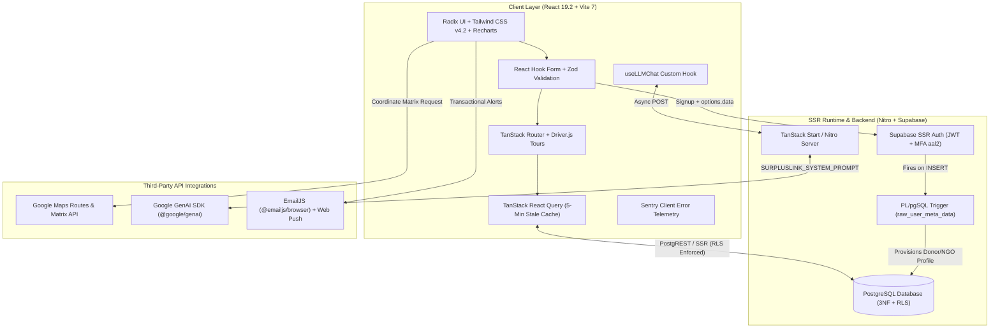
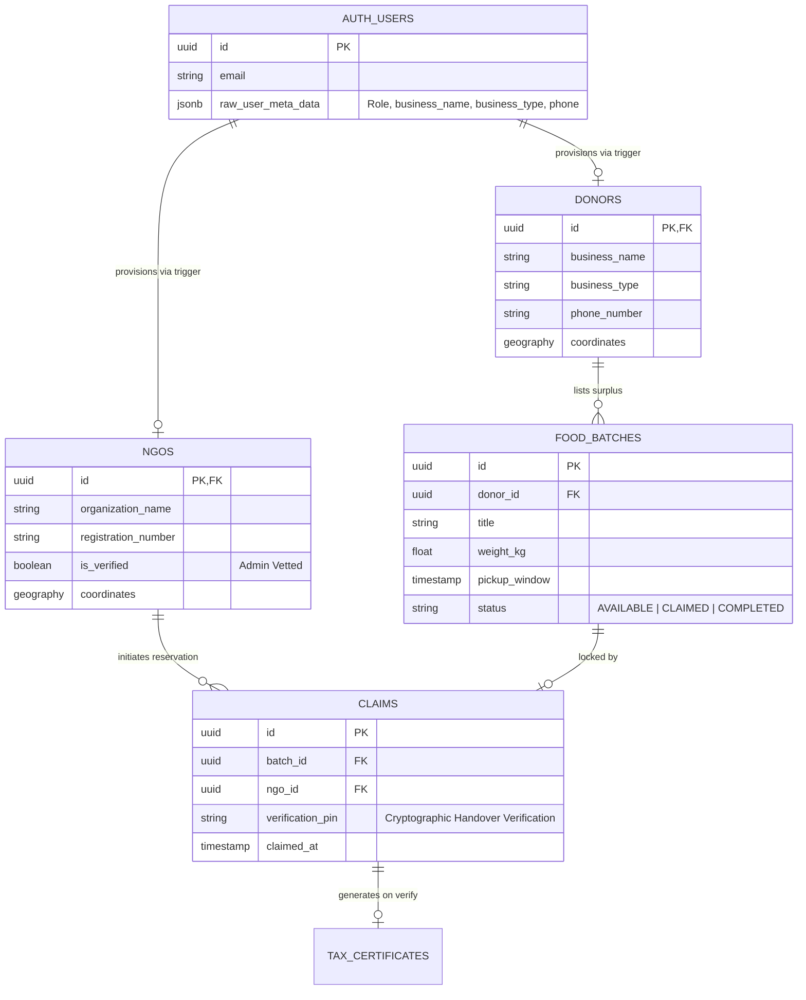

# SurplusLink | Enterprise B2B Food Logistics & Compliance Network

[](https://surplus-link-five.vercel.app)
[](https://react.dev/)
[](https://tanstack.com/start)
[](https://www.typescriptlang.org/)
[](https://supabase.com/)
[](https://tailwindcss.com/)

**SurplusLink** is a full-stack cloud logistics and compliance platform engineered to eliminate commercial food waste across South Africa while supplying verified community kitchens and non-profit organizations (NGOs)[cite: 6]. 

By bridging the operational gap between commercial food donors (supermarket chains, restaurants, agricultural producers) and registered NGOs, SurplusLink automates real-time inventory batching, proximity-based route matching, cryptographic handover verification, and **Section 18A tax compliance** auditing[cite: 3, 4, 6].

---

## Table of Contents
1. [Executive Summary & Problem Statement](#executive-summary--problem-statement)
2. [Project Context & My Engineering Contributions](#project-context--my-engineering-contributions)
3. [System Architecture & Technical Design](#system-architecture--technical-design)
4. [Complete Technology Stack](#complete-technology-stack)
5. [Database Schema & Security (PostgreSQL / RLS)](#database-schema--security-postgresql--rls)
6. [Core Platform Capabilities](#core-platform-capabilities)
7. [B2B SaaS Commercialization & Financial Model](#b2b-saas-commercialization--financial-model)
8. [Local Development & Deployment Guide](#local-development--deployment-guide)
9. [Administrative Access & Security](#administrative-access--security)

---

## Executive Summary & Problem Statement

Every day, commercial retailers discard tons of edible food due to approaching display dates or minor packaging imperfections. Concurrently, local NGOs face severe supply shortages. Three systemic barriers prevent efficient redistribution:
1. **Corporate Liability & Compliance Friction:** Retailers cannot hand over stock without an auditable chain of custody and verifiable Section 18A tax documentation[cite: 3, 4, 6].
2. **Logistical Blind Spots:** NGOs lack real-time visibility into where surplus stock is located and which batches are logistically viable to collect before spoilage[cite: 6].
3. **Counterproductive Market Pricing:** Traditional food recovery networks charge beneficiary charities monthly subscription fees (up to R800+/month) just to access donated food[cite: 2].

**SurplusLink** solves this by providing a 100% free utility for NGOs funded through **Enterprise B2B White-Label SaaS Licensing** for corporate retail networks[cite: 2, 4].

---

## Project Context & My Engineering Contributions

SurplusLink was developed collaboratively by an 8-member software engineering team. Within the project, I played key roles across **both Back-End and Front-End Development**, alongside leading the **B2B Financial & Commercialization Strategy**:

### 1. Back-End & Database Systems Engineering
* **Normalized PostgreSQL Schema Design:** Co-architected the relational database in Supabase (`@supabase/supabase-js` & `@supabase/ssr`) to maintain third normal form (3NF) integrity across authentication entities, commercial donors, verified NGOs, food batches, and claim reservations[cite: 6, 7].
* **Automated PL/pgSQL Triggers (`handle_new_user`):** Built backend database triggers that intercept `auth.users` insert events, parse the incoming JSONB `raw_user_meta_data` payload (extracting Donor/NGO role toggles, business classifications, and contact details from registration forms), and automatically provision the corresponding public entity records (`donors` or `ngos`).
* **Row-Level Security (RLS) & Multi-Tenant Isolation:** Implemented granular PostgreSQL RLS policies and MFA (`aal2`) security protocols ensuring donors can only mutate their own inventory batches, NGOs can only claim verified active stock, and administrative routes are strictly gated[cite: 6].
* **Server Runtime & AI Agent Integration:** Leveraged **TanStack Start** (`@tanstack/react-start`), **Nitro**, and the **Google GenAI SDK** (`@google/genai`) with a custom domain-specific system prompt to power an intelligent platform support assistant, alongside **Web Push** (`web-push`) for real-time browser notifications[cite: 7].

### 2. Front-End Application & State Engineering
* **Asynchronous State Caching & File-Based Routing:** Implemented `TanStack React Query` (`v5.83`) and `TanStack React Router` (`v1.168`) to eliminate prop-drilling, manage in-memory data caching, and execute background re-fetches upon window focus or 5-minute stale timers[cite: 6, 7].
* **Schema-Validated Multi-Step Registration Flows:** Built interactive onboarding views (`/register` and `/login`) utilizing `React Hook Form`, `Zod` schema validation, and accessible `Radix UI` primitives[cite: 7].
* **Geospatial Proximity Sorting & Telemetry:** Integrated the **Google Maps Routes API** into the NGO dashboard to dispatch distance-matrix requests comparing user coordinates against active food batches, sorting the live feed by real-time driving distance[cite: 3, 6]. Built interactive impact analytics with `Recharts`, onboarding walk-throughs with `Driver.js`, and error monitoring with `@sentry/react`[cite: 6, 7].
* **Custom AI Chat Hook (`useLLMChat`):** Developed the client-side state hook managing active conversation arrays and firing asynchronous POST requests to the backend LLM agent.

### 3. B2B SaaS Financial & Commercial Modeling
* **Enterprise White-Label Strategy:** Designed the commercial revenue architecture targeting Tier-1 retail conglomerates with privately branded, ERP-integrated instances[cite: 2, 4].
* **Unit Economics & Cost Modeling:** Mapped out the serverless operational baseline (fixed infrastructure vs. variable API scaling) and demonstrated how a single enterprise contract subsidizes regional non-profit operations[cite: 3, 5].

---

## System Architecture & Technical Design

SurplusLink utilizes a modern full-stack **React 19 + TanStack Start + Nitro** architecture paired with **Supabase PostgreSQL** for low idle overhead and elastic horizontal scaling[cite: 3, 7]:



* **Client Layer (`React 19.2` & `Vite 7`):** Renders responsive views using `Tailwind CSS v4.2` and `Radix UI` primitives[cite: 6, 7]. Forms are strictly validated on the client via `Zod` and `React Hook Form` before dispatching mutations[cite: 7].
* **State & Routing Layer (`TanStack Router` & `React Query`):** Enforces role-based route guards (`/donor`, `/ngo`, `/admin`)[cite: 6]. `React Query` maintains a 5-minute stale cache over PostgREST queries to minimize redundant database reads[cite: 7].
* **SSR & Backend Layer (`TanStack Start` & `Nitro`):** Handles server-side rendering, secure server functions, and API communication with the `@google/genai` assistant and `web-push` notification dispatchers[cite: 7].
* **Database & Auth Layer (`Supabase SSR`):** Manages JWT sessions, Multi-Factor Authentication (`aal2`), automated user-provisioning triggers, and Row-Level Security enforcement directly at the PostgreSQL engine level[cite: 6, 7].

---

## Complete Technology Stack

Derived directly from the production build configuration (`package.json`)[cite: 7]:

| Layer | Technologies & Packages |
| :--- | :--- |
| **Core Framework & Bundler** | `react` (`^19.2.0`), `react-dom` (`^19.2.0`), `@tanstack/react-start` (`^1.168.60`), `nitro` (`^3.0-beta`), `vite` (`^7.3.1`), `typescript` (`^5.8.3`)[cite: 7] |
| **Routing & State Caching** | `@tanstack/react-router` (`^1.168.0`), `@tanstack/react-query` (`^5.83.0`), `@tanstack/router-plugin`[cite: 7] |
| **Database & Authentication** | `@supabase/supabase-js` (`^2.110.0`), `@supabase/ssr` (`^0.12.4`), PostgreSQL with Row-Level Security (RLS)[cite: 6, 7] |
| **UI, Styling & Visualization** | `tailwindcss` (`^4.2.1`), `@radix-ui/*` primitives (Dialog, Select, Tabs, Tooltip, etc.), `recharts` (`^2.15.4`), `lucide-react`, `embla-carousel-react`, `sonner`[cite: 7] |
| **Forms & Schema Validation** | `react-hook-form` (`^7.71.2`), `zod` (`^3.24.2`), `@hookform/resolvers` (`^5.2.2`)[cite: 7] |
| **AI, Maps & Notifications** | `@google/genai` (`^2.21.0`), Google Maps Routes API, `@emailjs/browser` (`^4.4.1`), `web-push` (`^3.6.7`)[cite: 3, 7] |
| **UX Onboarding & Telemetry** | `driver.js` (`^1.9.0` for interactive guided tours), `@sentry/react` (`^11.0.0` for runtime monitoring)[cite: 6, 7] |
| **Code Quality & Tooling** | `eslint` (`^9.32.0`), `typescript-eslint` (`^8.56.1`), `prettier` (`^3.7.3`), `tsx` (`^4.23.12`)[cite: 7] |

---

## Database Schema & Security (PostgreSQL / RLS)

The PostgreSQL database is structured in 3NF to prevent update anomalies across interrelated user, donor, and NGO entities while maintaining complete auditability from listing to handover[cite: 3, 6]:



| Table / Entity | Primary Role & Key Attributes | Security & Relational Rules |
| :--- | :--- | :--- |
| **`auth.users`** | Managed Supabase authentication table storing credentials and `raw_user_meta_data` JSONB payloads. | Fires an automated `AFTER INSERT` PL/pgSQL trigger to provision role-specific profiles. |
| **`public.donors`** | Stores commercial donor profiles (`business_name`, `business_type`, `phone_number`, geospatial coordinates). | Linked `1:1` with `auth.users`. RLS restricts profile mutations to the authenticated owner[cite: 6]. |
| **`public.ngos`** | Stores charity profiles (`organization_name`, `registration_number`, `is_verified` status, coordinates). | Linked `1:1` with `auth.users`. Requires administrator verification before claiming stock[cite: 6]. |
| **`public.food_batches`** | Active and historical surplus listings (`title`, `weight_kg`, `pickup_window`, `status`)[cite: 6]. | Linked `M:1` to `donors`. Readable by verified NGOs; mutable only by the listing donor[cite: 6]. |
| **`public.claims`** | Reservation records linking an NGO to a food batch, including the cryptographic `verification_pin`. | Locks batch status to `CLAIMED`[cite: 6]. Upon PIN verification, transitions batch to `COMPLETED` and triggers Section 18A certificate generation[cite: 4, 6]. |

---

## Core Platform Capabilities

* **Donor Portal:** Commercial entities can batch surplus inventory, define pickup windows, verify physical collections via 4-digit PINs, and automatically download Section 18A tax certificates[cite: 4, 6].
* **NGO Logistics Feed:** Registered charities browse available donations sorted by real-time driving distance via the Google Maps Routes API, claim batches, and receive turn-by-turn collection instructions[cite: 3, 6].
* **Admin Governance Dashboard:** A secure portal (`/admin/login`) for administrators to approve new NGO registrations, review compliance audit logs, and resolve support tickets[cite: 3, 6].
* **Interactive Guided Tours & AI Support:** New users are greeted with automated step-by-step UI walkthroughs (`driver.js`) and have access to an integrated generative AI support assistant (`@google/genai`)[cite: 6, 7].

---

## B2B SaaS Commercialization & Financial Model

Unlike traditional food recovery platforms that charge non-profits monthly subscription fees, SurplusLink keeps NGO access **100% free** and monetizes corporate donors through a scalable B2B SaaS framework[cite: 2, 4]:

1. **Enterprise White-Label Licensing (Primary Revenue Engine):**
   * Major retail conglomerates require strict corporate governance and prefer not to share a public donation feed alongside direct competitors.
   * SurplusLink provides dedicated, privately branded portals integrated directly into corporate ERPs, allowing distribution centers to route surplus exclusively to pre-approved charity partners[cite: 2, 4].
   * **Revenue Structure:** Upfront ERP integration fees (~R300k+), annual SaaS licensing (~R250k–R500k+ offset by Section 18A corporate tax savings), and monthly maintenance retainers[cite: 2, 4].
2. **Community Wallet Platform Fee:**
   * A standard **5%–8% operational fee** on micro-donations contributed toward third-party rescue logistics[cite: 2, 4].
3. **Anonymized Macro-Analytics:**
   * Aggregated food waste trends, surplus heatmaps, and supply chain inefficiency reports licensed to municipal planners, agricultural departments, and environmental researchers[cite: 2].
4. **ESG & Methane-Reduction Grants:**
   * Positioned for domestic and international green-tech subsidies targeting verifiable organic landfill diversion[cite: 2].

---

## Local Development & Deployment Guide

### Prerequisites
* **Node.js**: Version 18 or higher (v22 recommended)[cite: 6, 7]
* **npm**: Version 9 or higher[cite: 6]
* **Supabase Account**: An active Supabase project for database and authentication services[cite: 6]

### Running Locally

1. **Clone the repository and install dependencies:**
   ```bash
   git clone https://github.com/YOUR_GITHUB_USERNAME/surpluslink.git
   cd surpluslink
   npm install
   ```

2. **Set up environment variables:**
   Create a `.env` file in the root directory and configure your keys[cite: 6]:
   ```env
   VITE_SUPABASE_URL=your_supabase_url
   VITE_SUPABASE_ANON_KEY=your_supabase_anon_key
   ```

3. **Initialize the Database:**
   Open the **Supabase SQL Editor** and execute your schema scripts to provision the normalized tables, triggers, and Row-Level Security (RLS) rules[cite: 6].

4. **Available Scripts:**
   ```bash
   # Start the Vite development server at http://localhost:5173
   npm run dev

   # Build for production
   npm run build

   # Preview the production build locally
   npm run preview

   # Run ESLint and Prettier code formatting
   npm run lint
   npm run format
   ```

### Deploying to Production (Vercel)

1. Push your code to a GitHub repository and import the project into **Vercel**[cite: 6].
2. Add `VITE_SUPABASE_URL` and `VITE_SUPABASE_ANON_KEY` to the Vercel **Environment Variables** section and click **Deploy**[cite: 6].
3. In your **Supabase Dashboard**, open **Authentication → URL Configuration**, set the **Site URL** to your Vercel production URL (`[https://surplus-link-five.vercel.app](https://surplus-link-five.vercel.app)`), and add that URL to the allowed **Redirect URLs** so registration email confirmation links resolve properly after deployment[cite: 6].

---

## Administrative Access & Security

To access the Admin dashboard, navigate to `/admin/login` and register using an authorized administrator access code[cite: 6]. For architectural walkthroughs or demo credentials, please reach out via LinkedIn or GitHub.